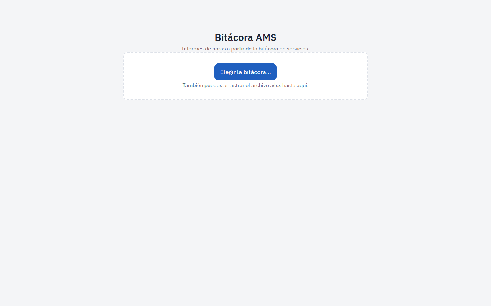
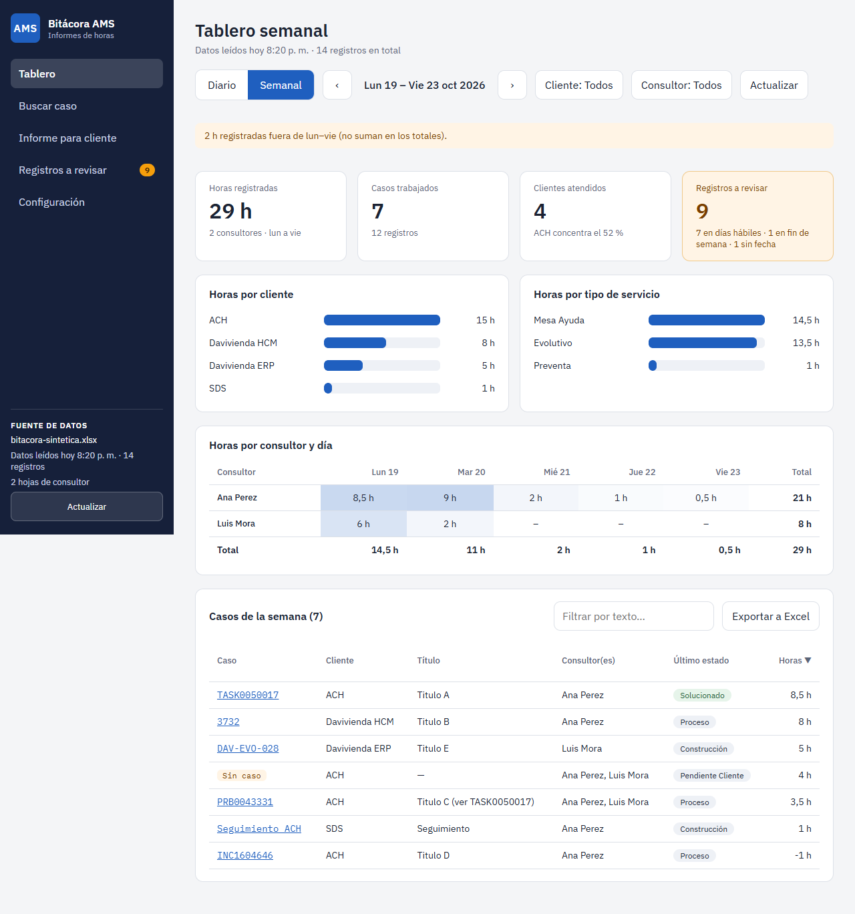
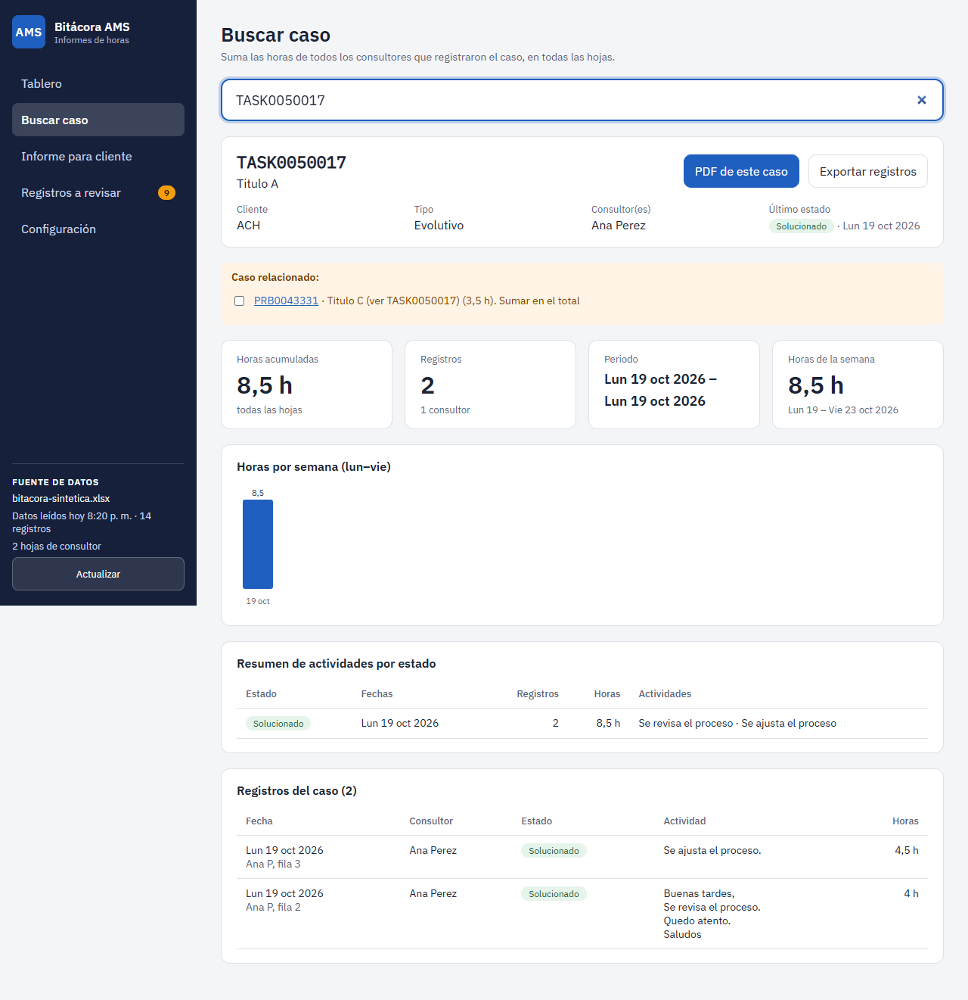
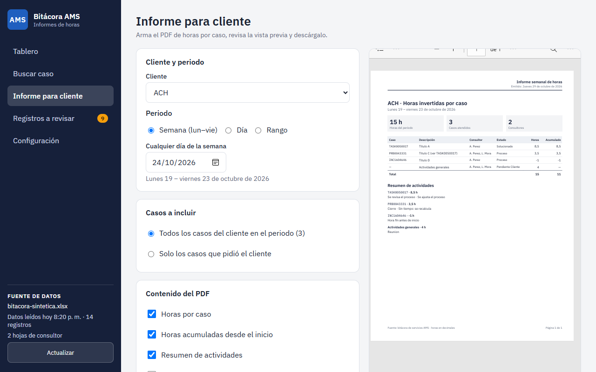
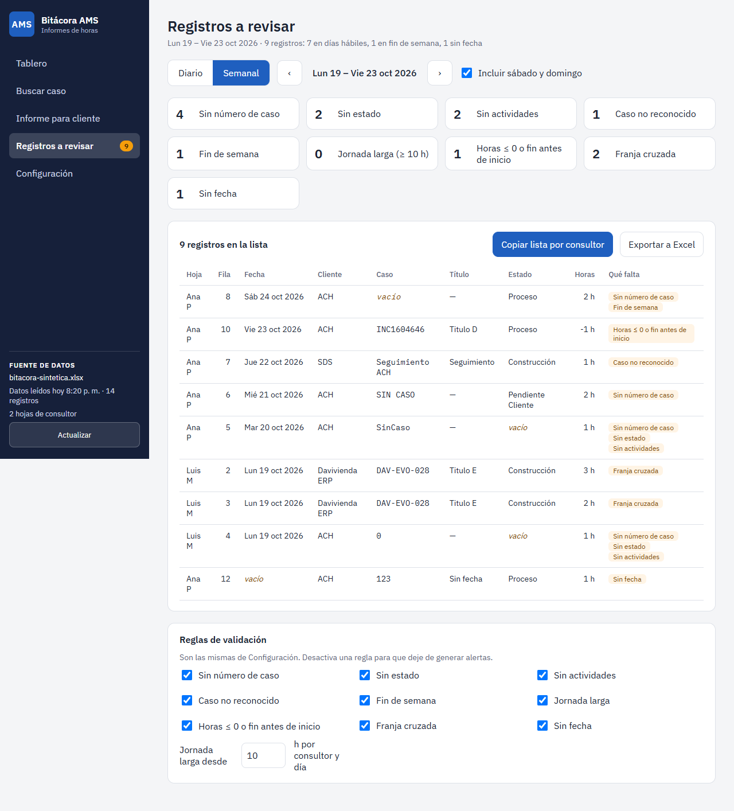
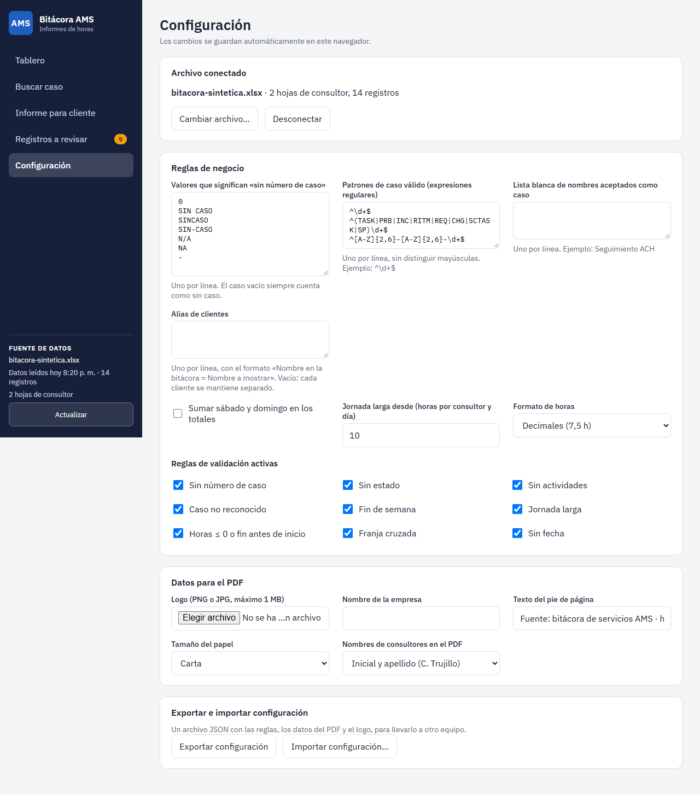

# Bitácora AMS · Informes de horas

Una aplicación que lee la **Bitácora Servicios AMS** (el Excel que llenan los consultores) y le muestra, sin tocarla:

- cuántas horas se invirtieron por cliente, consultor, día y caso;
- las horas totales de cualquier caso, sumando todas las hojas;
- qué registros están incompletos, con la lista lista para enviar a cada consultor;
- el **PDF semanal para el cliente**, con resúmenes que usted puede editar.

**No modifica la bitácora**: solo la lee. **No usa internet**: nada sale de su computador. **No hay nada que instalar**: es un solo archivo, `BitacoraAMS.html`.

> Las capturas de este documento usan un libro de **datos inventados**, no la bitácora real.

---

## 1. Qué necesita

- **Microsoft Edge** o **Google Chrome** (recomendados). Con otros navegadores la app funciona, pero hay que elegir el archivo cada vez (ver «Preguntas frecuentes»).
- La bitácora **sincronizada con OneDrive** en su computador (siguiente paso).

## 2. Sincronizar la bitácora con OneDrive (una sola vez)

La app lee el archivo desde su computador, así que OneDrive debe tenerlo allí.

1. Abra en el navegador el enlace de la bitácora (SharePoint, sitio **Colombia**, carpeta **Bitacoras**).
2. Suba un nivel, a la carpeta que contiene **Bitacoras**, y marque la carpeta con el círculo de su izquierda (sin abrirla).
3. En la barra de arriba pulse **Sincronizar** (si no aparece, pulse **Agregar acceso directo** → **Mis archivos**). Si el navegador pregunta si abre OneDrive, acepte.
4. Espere un momento. En el **Explorador de archivos**, bajo OneDrive, aparecerá la carpeta **Bitacoras**.
5. Entre a la carpeta, haga clic derecho sobre **Bitácora Servicios AMS.xlsx** y elija **Mantener siempre en este dispositivo**.

Sabrá que quedó bien cuando el archivo pese varios MB, tenga el icono verde de Excel y un **círculo verde con una palomita** en la columna Estado.

> **Ojo:** un archivo de **1 KB** con el tipo «Acceso directo a Internet» **no sirve**: solo abre la página web. Debe ser el Excel real.

## 3. Abrir la aplicación y conectar la bitácora

1. Haga **doble clic** en `BitacoraAMS.html` (se abre en su navegador).
2. La primera vez pulse **Elegir la bitácora…** y seleccione el Excel dentro de su carpeta de OneDrive.

3. Las próximas veces la app recuerda el archivo: solo pulse **Conectar con la bitácora** y, si el navegador pregunta, elija **Permitir**. Verá los datos más recientes.
4. Para traer cambios nuevos mientras la app está abierta, pulse **Actualizar**. Dice cuándo se leyó por última vez: «Datos leídos hoy 3:05 p. m. · 428 registros».

Los cambios de los consultores llegan a la app cuando OneDrive ya los bajó a su computador. Si acaban de guardar, espere a que OneDrive termine de sincronizar.

## 4. Tablero

- **Diario / Semanal / Rango** y las flechas cambian el periodo (la semana es de lunes a viernes). Con **Rango** elige las fechas **Desde** y **Hasta** (por ejemplo, del 21 de septiembre al 21 de octubre); las flechas desplazan el rango completo y, en periodos largos, el cuadro de horas se agrupa por semana.
- **Cliente** y **Consultor** filtran; puede marcar varios.
- Las cuatro tarjetas resumen horas, casos, clientes y los **registros a revisar** (pulse esa tarjeta para verlos).
- El cuadro **Horas por consultor y día** pinta en naranja las jornadas largas (10 h o más por defecto).
- La tabla de **casos** se ordena pulsando los títulos, se filtra por texto y se baja a Excel con **Exportar a Excel**.
- Si hubo trabajo en sábado o domingo, aparece el aviso «X h registradas fuera de lun–vie»: no suma en los totales (se puede cambiar en Configuración).

## 5. Buscar caso

Escriba el número o código del caso (o parte del título) y elija de la lista. Verá:

- las **horas acumuladas** de todos los consultores y todas las hojas, el periodo y los registros;
- las **horas por semana**; lo trabajado en fin de semana va en naranja;
- el **resumen de actividades por estado**;
- si el título menciona otro caso, un aviso de **caso relacionado** con la casilla **Sumar en el total**;
- cada registro con su hoja y fila de origen (para encontrarlo en el Excel).

**Exportar registros** baja la lista a Excel y **PDF de este caso** abre el informe para ese caso.

## 6. Informe para cliente (el PDF semanal)

1. Elija el **cliente** y el **periodo** (una semana, un día o un rango de fechas).
2. En **Casos a incluir**, deje «todos los casos» o elija «solo los que pidió el cliente» y **pegue los códigos** (separados por coma, espacio o salto de línea). Si alguno no aparece en el periodo, la app se lo avisa.
3. Marque qué lleva el PDF: horas por caso, acumulado, resumen, detalle por día, consultor y gráfica.
4. Lea la **Verificación previa** (recuadro naranja). Si hay horas **sin número de caso**, en **fin de semana** o **sin estado**, decida si las agrupa («Actividades generales»), las incluye o las excluye.
5. Edite el **resumen por caso**. La app propone un borrador con las actividades registradas (sin saludos ni firmas); usted lo corrige. **Sus cambios se guardan** por cliente, caso y periodo; **Restaurar borrador** lo devuelve a la propuesta.
6. Revise la **vista previa** a la derecha, que se actualiza sola.
7. Pulse **Descargar PDF**, o **Generar para todos los clientes** para obtener un `.zip` con un PDF por cliente.

El archivo se llama `Informe_horas_<Cliente>_<AAAA-MM-DD>_al_<AAAA-MM-DD>.pdf`.

## 7. Registros a revisar

Muestra los registros incompletos o raros del periodo. Cada tarjeta es un filtro (pulse para activarla):

| Alerta | Qué significa |
|---|---|
| Sin número de caso | caso vacío, 0, «SIN CASO», «SinCaso»… |
| Sin estado / Sin actividades | el campo está vacío |
| Caso no reconocido | tiene un valor, pero no parece un número de caso (p. ej. «INVENTARIOS») |
| Fin de semana | registrado en sábado o domingo |
| Jornada larga | un consultor con 10 h o más en un día |
| Horas ≤ 0 | horas en cero o negativas, o fin antes del inicio |
| Franja cruzada | dos registros del mismo consultor que se traslapan en el mismo día |
| Sin fecha | falta la fecha |

Pulse **Copiar lista por consultor** y pegue el texto en un correo o en Teams: viene agrupado por consultor, con hoja y fila de cada registro, para pedir las correcciones. **Exportar a Excel** baja la misma lista.

En el panel **Reglas de validación** puede apagar las reglas que no necesite y cambiar el umbral de jornada larga.

## 8. Configuración

- **Reglas de caso:** qué valores cuentan como «sin caso», qué formatos son un caso válido y una **lista blanca** de nombres aceptados como caso (por ejemplo «Seguimiento ACH», para que deje de aparecer como no reconocido).
- **Alias de clientes:** para unir dos nombres en uno (por defecto, cada cliente se mantiene separado).
- **Totales y formato:** si sábado y domingo suman, el umbral de jornada larga y si las horas se ven como `7,5 h` o `7:30`.
- **Datos para el PDF:** logo (PNG o JPG), nombre de la empresa, texto del pie, papel Carta o A4 y cómo se escriben los consultores («C. Trujillo» o nombre completo).
- **Exportar / importar configuración:** guarda todo en un archivo para llevarlo a otro computador.

Todo se guarda solo, en este navegador.

---

## Preguntas frecuentes

**Pulso «Conectar con la bitácora» y no pasa nada, o pide permiso cada vez.**
El navegador exige su permiso para leer el archivo cada vez que reabre la app. Pulse **Permitir**. Si pidió «Permitir solo esta vez», volverá a preguntar.

**Dice «No se pudo leer el archivo».**
Causas probables: el Excel está bloqueado por otro programa, o OneDrive lo tiene **solo en la nube**. Haga clic derecho sobre el archivo en el Explorador y elija **Mantener siempre en este dispositivo**. Si fue movido o renombrado, elíjalo de nuevo con **Elegir la bitácora…**.

**Dice que el archivo no tiene hojas de consultor.**
La app reconoce las hojas de consultor porque su primera fila empieza por **Fecha** y trae **Cliente** y **Caso**. Verifique que eligió la bitácora correcta. Un consultor nuevo aparece solo, sin configurar nada.

**No me deja recordar el archivo / lo pide siempre.**
Con Firefox o Safari, o si el navegador bloquea el almacenamiento, la app no puede recordar el archivo: elíjalo o **arrástrelo** hasta la ventana cada vez. Con Edge o Chrome sí lo recuerda.

**Los datos no están al día.**
Pulse **Actualizar** y revise que OneDrive haya terminado de sincronizar (icono de nubes en la barra de tareas).

**Los totales no coinciden con una tabla dinámica del Excel.**
La app suma la columna **Tiempo Invertido** (si está vacía, calcula Hora Fin − Hora Inicio) y no usa la columna «HORAS TOTALES» ni el factor de 1,75. Los registros de sábado y domingo no suman por defecto.

**¿Qué pasa si mis casos tienen un espacio al final o van en minúsculas?**
La app los trata como el mismo caso (`TASK0050017 ` = `task0050017`).

**¿Es seguro?**
Sí. La app solo **lee** el archivo, no lo modifica, no se conecta a internet y no envía datos a ningún lado. Sus ajustes y los resúmenes que edita quedan guardados en su propio navegador.

**Mover o copiar la app.**
Basta con copiar el archivo `BitacoraAMS.html`. En otro computador hay que volver a elegir la bitácora una vez (y, si quiere, importar su configuración).
